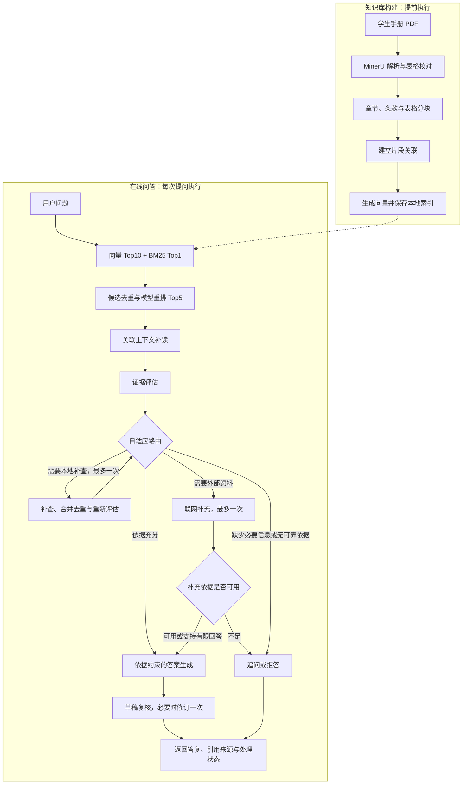

# 绍兴大学学生手册 RAG 问答

基于学生手册的知识库问答，支持混合检索、重排、证据判断和带页码引用的回答，可直接运行脚本或作为 Python 包调用，无需常驻后台服务。

## 安装准备

- 安装 Python 3.11 或更高版本。
- 下载本仓库完整内容；已附带手册、分块和向量索引，无需重新解析 PDF、生成向量或下载 MinerU。
- 准备百炼北京区域的 API Key 和对应请求地址，并确保账号可调用 `config/` 中设置的模型。

以下命令在项目根目录的 PowerShell 中执行：

```powershell
python -m venv .venv
.\.venv\Scripts\python.exe -m pip install -e .
New-Item -ItemType Directory -Path .runtime -Force | Out-Null
if (-not (Test-Path .runtime/dashscope.local.json)) {
    Copy-Item config/dashscope.example.json .runtime/dashscope.local.json
}
```

打开 `.runtime/dashscope.local.json`，填写两项配置：

```json
{
  "api_key": "",
  "base_url": ""
}
```

`api_key` 填自己的密钥；`base_url` 填与密钥匹配的请求地址，例如 `https://dashscope.aliyuncs.com/compatible-mode/v1`，也支持百炼北京工作空间的 `https://<工作空间域名前缀>.cn-beijing.maas.aliyuncs.com/compatible-mode/v1`。不要追加 `/chat/completions`，当前不支持其他厂商的地址。

该本地配置文件不会被 Git 跟踪。也可以用 `DASHSCOPE_API_KEY` 和 `DASHSCOPE_BASE_URL` 环境变量提供配置。

## 使用方式

### 终端问答

```powershell
.\.venv\Scripts\python.exe scripts/answer_question.py --question "申请国家奖学金需要满足哪些条件？"
```

不写 `--question` 时，会在终端提示输入问题。默认开启证据判断、按需网页补查和草稿复核，返回回答及引用页码。

常用开关可组合使用：

| 参数 | 作用 |
| --- | --- |
| `--no-web` | 关闭网页补查，模型 API 仍需联网 |
| `--no-crag` | 关闭证据判断、自适应路由及网页补查 |
| `--no-reflection` | 关闭草稿复核及其可能触发的一次修订 |
| `--retrieval-offline` | 检索只使用已有缓存；缺缓存时报错，后续阶段仍可能调用 API |
| `--dry-run` | 使用已有检索缓存保存提示词，不生成回答、不调用 API；仍需有效格式的配置 |

例如，仅关闭网页补查：

```powershell
.\.venv\Scripts\python.exe scripts/answer_question.py --question "图书可以借多久？" --no-web
```

模型 API 调用可能产生费用；`--no-web` 不等于完全离线运行。

### 在 Python 中调用

在已安装本包的 Python 环境中：

```python
from student_handbook_rag import HandbookRAG

rag = HandbookRAG(project_dir="下载后的项目目录")
result = rag.ask("申请国家奖学金需要满足哪些条件？", allow_web=False)
print(result["answer"])
print(result["sources"])
```

`allow_web=False` 关闭网页补查；`crag=False` 关闭证据判断及网页补查；`reflection=False` 关闭草稿复核。同一个 `rag` 对象可以连续调用 `ask()`，程序结束即可退出。

## 项目实现

项目围绕学生手册中的制度、条款与表格构建可追溯的问答链路，包括提前执行的知识库构建，以及每次提问时执行的检索、证据判断、生成与复核。

### 已实现的功能

| 模块 | 实现内容 | 作用 |
| --- | --- | --- |
| 文档解析与预处理 | 使用 MinerU 解析 PDF，合并校对后的结构化表格，保留原文与 PDF 来源页码 | 将手册整理为可检索、可溯源的知识数据 |
| 结构感知分块 | 根据章节、条款和表格结构进行规则分块，为片段保留块 ID 与来源信息 | 减少制度条款被随意切断，保留引用依据 |
| 向量化与混合检索 | 使用 `qwen3.7-text-embedding` 生成 1024 维向量，采用余弦相似度 Top10 与 BM25 Top1 补充召回，按块 ID 去重 | 结合语义匹配与关键词匹配，覆盖不同提问方式 |
| 模型重排 | 使用 `qwen3.7-text-rerank` 对合并候选精排，选取前 5 个片段 | 将更相关的资料优先交给后续处理 |
| 关联上下文补全 | 建立正文与表格等片段的关联，在数量和字符预算内补读直接关联内容 | 补充表格说明、适用条件及相关条款，减少片段脱离上下文的问题 |
| CRAG 与自适应路由 | 评估证据充分性和问题明确程度，选择本地回答、本地补查、联网补充、追问或拒答 | 根据当前资料决定下一步，避免对所有问题使用固定生成路径 |
| 依据约束生成与草稿复核 | 使用 `qwen3.7-plus`，通过 Prompt / Context Engineering 组织问题、编号资料与回答约束；检查草稿的事实、条件、遗漏和引用，必要时修订一次 | 辅助核对答案与依据的一致性，返回实际引用的原文及页码 |
| 工程化封装 | 向量生成断点续跑、查询向量与重排缓存、独立运行记录、Token 用量记录，以及统一 Python 包入口 | 支持重复调用、结果追溯和问题排查 |

关键词补充只取 BM25 第一名；若与向量候选重复，则不再补入第二名。因此重排前最多有 11 个候选。前 5 个重排结果还会按关联关系补读，上下文总量受字符预算控制。

### 整体流程



本地补查复用混合检索和重排链路，最多执行一轮，并在合并资料后重新评估；预算耗尽后不再循环补查。联网分支限定官方来源，将带来源链接的摘要作为补充资料。

草稿复核在生成后执行，依据所给资料检查答案。复核失败或无法可靠修正时返回拒答；完成一次修订后标记为 `revised_not_rechecked`，不再进行第二轮语义复核。整个流程由 Python 函数组织，外部程序通过 `HandbookRAG.ask()` 调用，并获得答案、实际引用资料、路由状态和用量等结构化结果。
